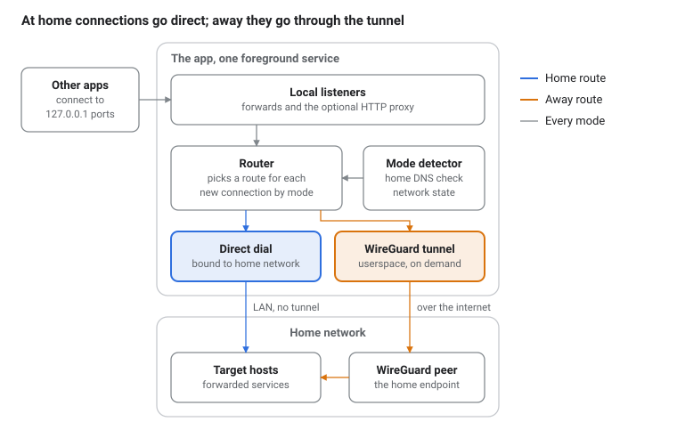

# WirePlug — Requirements

Oct 4, 2026 · @Ed

## Overview and goals

This Android app gives other apps access to services on the user's home network through ports on the phone itself, using a WireGuard tunnel that runs entirely inside the app. It needs no system VPN, no VPN slot and no root. At home it connects straight to the LAN; away from home it goes through the tunnel. The local ports other apps use are the same in both cases.

Goals:

- Reach private services from specific apps without Android's VPN permission or its one-active-VPN limit.
- Make on-network and off-network use transparent: the same `127.0.0.1` ports work in both places, and client apps need no reconfiguration.
- Run the tunnel only when it is needed: away from home, and while a forward is in use.
- Provide a UI to see connection status and to manage forwarding hosts, so nothing needs editing by hand.

The app is named WirePlug, its package identifier is org.metalmind.wireplug, and the source is published at git.metalmind.org/ed/wireplug, which is also the Go module path. "The app" is used throughout this document.

## Scope

Version 1 covers one WireGuard peer, TCP forwards from local ports to hosts inside the home network, and an optional local HTTP proxy.

In scope for v1:

- One tunnel configuration, with one peer and a standard WireGuard private key, public key, endpoint and allowed IPs.
- A list of TCP forwards, each mapping a local port to an IP address and port on the home network.
- An optional local HTTP/CONNECT proxy that reaches the home network by the same two routes (direct at home, tunnel away).
- A home DNS check: a user-configured host name, resolvable only on the home network, matched against a configured TXT value or address.
- A status screen, a configuration UI and a foreground-service notification.

Out of scope for v1:

- System-wide or per-app VPN through `VpnService`, and SOCKS5.
- UDP forwarding, ICMP and IPv6-only targets.
- Multiple WireGuard peers or multiple tunnels at once.
- Any server component. The home side is an ordinary WireGuard peer the owner already runs.

Assumptions:

- The home WireGuard endpoint is reachable from outside, by IP or a DDNS name.
- Home LAN addresses are the same whether the phone is on the LAN or reaching it through the tunnel (the tunnel's allowed IPs cover the LAN subnet). Forwards name each target by one IP address, not a host name.

## Architecture

A Kotlin layer decides the mode and a Go library does all the networking, so each connection's route is chosen when it arrives, not when its listener was created.

Listeners stay up in every mode. In Home mode the router sends new connections straight to the LAN; in Away mode it sends them through the on-demand WireGuard tunnel to the home peer.

- **Kotlin layer:** the UI, the foreground service, encrypted configuration storage and the mode detector.
- **Go library (a `gomobile` AAR):** the listeners, the router, the direct dialer, the userspace WireGuard tunnel and the status feed.

## Functional requirements

The app chooses between three modes from the current network state and applies the same forwards in each. Time figures are targets to confirm during testing.

- **Home:** the home DNS check passes on the current network. Forwards and the proxy connect directly to the target over that network, and the tunnel is down.
- **Away:** any other network with internet. Forwards and the proxy connect through the WireGuard tunnel.
- **Offline:** no usable network. Listeners stay up, and connections fail quickly with a clear error.

### Tunnel lifecycle

- **F1.** In Away mode the tunnel is brought up on demand, when a client first connects to a forward or the proxy, and not before. A setting can keep it up continuously instead.
- **F2.** After the tunnel is up, the first connection completes within 5 s on a normal mobile connection.
- **F3.** The tunnel is torn down after an idle period (default 60 s, configurable) with no open connections, and is never torn down while a connection is open.
- **F4.** On entering Home mode, new connections go direct at once. Connections already open through the tunnel run to completion, and the tunnel is then torn down.
- **F5.** On a network change (Wi-Fi to cellular, a different Wi-Fi), the app re-evaluates the mode, re-resolves the endpoint hostname and rebuilds the tunnel's UDP socket. Open tunnelled connections may drop, but new connections work without user action.

### Home network detection

- **F6.** Home mode is active when the home DNS check passes on the current network. The check looks up a user-configured host name that is resolvable only on the home network and compares the answer with a user-configured value. A TXT record is preferred, for example `internal.domain` with the TXT value `True`. Where the user cannot set a TXT record, an A record is used instead, for example `internal.domain` with the address `10.11.12.13`.
- **F7.** Optional reachability probe, not required for home detection: when a probe host and port are set, the app confirms Home with a TCP connect to that LAN address (1 s timeout) before using direct mode. A failed probe means Away. This guards against an unrelated network that also passes the DNS check.
- **F8.** The lookup runs on every network change, with a 2 s timeout. No answer, a different answer, an error or no configured check means Away, and the status screen shows the latest result.

### Forwards

- **F9.** A forward has a name, a local port, a remote IP address and port, and an enabled switch. The same address is used in Home and Away mode, and each forward can point at a different host through the one tunnel.
- **F10.** Listeners bind to `127.0.0.1` only. They stay bound in every mode while the service runs, so a client never sees a refused connection just because the mode changed.
- **F11.** Forward targets are IP addresses and need no DNS. Host names in proxy requests resolve through the tunnel's DNS server in Away mode, and through the system resolver on the home network in Home mode.
- **F12.** Adding, editing or removing a forward takes effect without restarting the service. Removing one closes its open connections.
- **F13.** Saving a forward with a local port already in use is rejected, naming the conflicting forward or the failure.

### HTTP proxy (optional)

- **F14.** A local HTTP proxy with `CONNECT` support can be enabled on a configurable `127.0.0.1` port, protected by a username and password.
- **F15.** The proxy uses the same Home and Away routing as the forwards. In both modes it reaches only destinations inside the tunnel's allowed IPs, so behaviour is identical on and off the home network. Other destinations get a `502` with a reason.

### Service and configuration

- **F16.** A main on/off switch starts and stops a foreground service. The service runs only while the switch is on and at least one forward or the proxy is enabled.
- **F17.** The tunnel configuration can be imported from a standard WireGuard `.conf` file or the clipboard, and edited by hand. The endpoint may be a hostname.
- **F18.** An option starts the service at device boot when the main switch was on.

## UI requirements

The app has a status screen as its home and five configuration screens reached from a settings menu, plus a persistent notification. Built with Jetpack Compose and Material 3.

### Wireframes

Low-fidelity SVG wireframes are kept in the repository under [`docs/wireframes/`](wireframes/). They illustrate the screens described below and add no requirements; where they differ from the text, the text wins.

| File | Shows |
| --- | --- |
| [`00-overview.svg`](wireframes/00-overview.svg) | All ten screens on one sheet |
| [`01-status-away.svg`](wireframes/01-status-away.svg) | Status screen: Away, tunnel up, with a warning |
| [`02-status-home.svg`](wireframes/02-status-home.svg) | Status screen: Home, direct |
| [`03-settings.svg`](wireframes/03-settings.svg) | Settings menu that links the configuration screens |
| [`04-tunnel.svg`](wireframes/04-tunnel.svg) | Tunnel configuration |
| [`05-home-network.svg`](wireframes/05-home-network.svg) | Home network: the DNS check and the optional probe |
| [`06-forwards.svg`](wireframes/06-forwards.svg) | Forwards list |
| [`07-edit-forward.svg`](wireframes/07-edit-forward.svg) | Forward edit form with the Test button |
| [`08-proxy.svg`](wireframes/08-proxy.svg) | HTTP proxy |
| [`09-behaviour.svg`](wireframes/09-behaviour.svg) | Behaviour |
| [`10-notification.svg`](wireframes/10-notification.svg) | Ongoing notification, two example states |

### Status screen

The top of the screen holds the main on/off switch, the current mode (Home, Away or Offline) and, in Home mode, the home host name that matched. Below it:

- **Tunnel:** state, time since last handshake, bytes sent and received, and the endpoint in use.
- **Forwards:** one row each with name, local port and target, the route in use (Direct or Tunnel), state, and open connection count.
- **Proxy:** state and local port, when enabled.
- **Warnings:** each shown with a button to fix it. Examples are no home DNS name set, notification permission denied, and battery restrictions that may stop the service.
- **Log:** the last 200 lines, viewable and copyable, never containing keys or the proxy password.

The overall state is one of these:

| State | When | Detail shown |
| --- | --- | --- |
| Off | Main switch is off; no listeners | Nothing running |
| Home, direct | Home DNS check passes; tunnel down | Home DNS name, probe result if set |
| Away, tunnel idle | Other network; nothing connected, tunnel not up | Idle timeout setting |
| Away, connecting | Handshake in progress | Endpoint and elapsed time |
| Away, tunnel up | Recent handshake | Handshake age, bytes sent and received |
| Offline | No usable network | Listeners up, connections fail fast |
| Error | Bad key, endpoint unreachable or no handshake within 10 s | Plain-language reason and a retry action |

### Configuration screens

- **Tunnel:** import a `.conf` file or paste from the clipboard, or edit the fields: private key (masked, never displayed in full), peer public key, endpoint, allowed IPs, tunnel address, DNS server and keepalive. Also the idle timeout and the keep-tunnel-up option.
- **Home network:** the host name, the record type (TXT or A) and the expected value or address, with the result of the latest lookup. Optional probe host and port.
- **Forwards:** a list with an enable switch per row, and add, edit and delete. The edit form has the fields from F9 and a Test button that opens a connection by the route currently in use and reports success or the error.
- **Proxy:** enable switch, local port, username, and a generated password with a copy button.
- **Behaviour:** start at boot, and notification options.

### Notification

The foreground service shows an ongoing notification with the mode and tunnel state, updated on every change, and a Stop action.

## Android platform requirements

The app targets a minimum of Android 8.0 (API 26), and the current stable target SDK at build time. It is distributed as a signed APK for sideloading; Play Store policy is out of scope. The platform behaviours marked *verify* are from memory of Android's rules and must be confirmed in the first spike.

| Permission | Needed for | Notes |
| --- | --- | --- |
| `INTERNET`, `ACCESS_NETWORK_STATE` | Sockets, network callbacks, the network's DNS servers | Normal permissions, granted at install |
| `FOREGROUND_SERVICE` plus a service type | Keeping listeners and the tunnel alive | Android 14 and later require a declared type; choose and justify one |
| `POST_NOTIFICATIONS` | The ongoing service notification | Runtime permission on Android 13 and later |
| `RECEIVE_BOOT_COMPLETED` | Optional start at boot | Used only if the setting is on |
| `ACCESS_LOCAL_NETWORK` | Direct connections to the LAN in Home mode | Runtime permission on Android 17 and later for apps targeting API 37. Without it, Home falls back to the tunnel. DNS on port 53 is exempt, so the home check works without it |

### Behaviour requirements

- **P1. Home name lookup.** Send the lookup to the current network's own DNS servers over a socket bound to that network, so a Private DNS provider or another VPN cannot hide the home name. A direct query is also needed to read TXT records, which the platform resolver does not expose on API 26 to 28. It needs no runtime permission and no location access, and must work while only the foreground service is running, including after a boot start. *Verify* this on a device with Private DNS set to a named provider (F6, F8).
- **P2. Network binding.** In Home mode, direct sockets are bound to the home  `Network` rather than left to the default route. In Away mode the WireGuard UDP socket is bound to the current default network and rebound when it changes.
- **P3. Service lifetime.** The service is sticky. After process death or a reboot it restores its configuration, rebinds all listeners and returns to the correct mode without opening the UI.
- **P4. Battery.** No periodic wake-ups while the tunnel is down. WireGuard keepalive (25 s) runs only while the tunnel is up. The app links to the system battery settings but does not require an exemption.
- **P5. Other VPNs.** The app works alongside a system VPN because it needs no `VpnService`. When another VPN is active, both direct and tunnel traffic pass through it unless sockets are bound to the underlying network. This is documented as a known behaviour, not handled in v1.
- **P6. Background restrictions.** If the system or the user restricts background activity for the app, the status screen shows a warning instead of failing silently.

## Security and privacy requirements

The owner accepts that any app on the phone can reach an enabled forward. A network that deliberately answers the home DNS check can still trigger Home mode.

- **S1. Key storage.** The private key is stored encrypted with a key held in the Android Keystore. It is never logged, never shown in full, and is excluded from backups and device transfers.
- **S2. Loopback exposure.** Listeners bind to `127.0.0.1`, but any app on the device can connect to a loopback port. Forwards have no authentication in v1, so while a forward is enabled, any installed app can reach its target. The UI states this next to the forwards list. Per-forward authentication is not possible for arbitrary TCP protocols, so the mitigation is the enable switch. The owner accepts this for v1, with no pause action.
- **S3. Proxy credentials.** The proxy requires a username and password. The default password is random and at least 16 characters, and is compared in constant time.
- **S4. Look-alike networks.** Any network can run a DNS server that answers the home name. In Home mode the app sends unencrypted traffic to private LAN addresses, so such a network could receive it. The reachability probe (F7) confirms something answers at a known address but does not prove it is the real host. Matching the configured TXT value or address (F6) filters accidental matches, such as a captive portal that answers every name, but not a deliberate one.
- **S5. Direct mode is unencrypted by the app.** In Home mode traffic is exactly as secure as the LAN and the application protocol, the same as using the service at home without the app.
- **S6. Logging.** Logs contain forward names, modes, endpoint addresses and error reasons. They never contain keys, passwords or traffic content.
- **S7. Imported configuration.** A `.conf` file is parsed defensively. Unknown or unsupported directives are reported to the user and not silently dropped. Clipboard text is not stored unless the user imports it.
- **S8. Attack surface.** The only exported component is the launcher activity. No network service listens on any interface other than loopback.

## Go library changes

The existing `wgproxy.go` is an uncompiled sketch with a single always-on tunnel, package-level state and three functions. It needs to become an engine that owns routing, on-demand tunnel lifetime and status. The library is bound to Android with `gomobile bind`, which allows only simple types, `error`, exported structs with methods, and interfaces the Kotlin side implements. Collections cross the boundary as JSON strings.

- **L1. Engine object.** Replace the globals with an exported `Engine` created by `NewEngine(host Host)`, so the service can hold it, restart it and test it.
- **L2. Mode and routing.** `SetMode(mode string)` takes `home`, `away` or `offline`. The engine picks the route for each accepted connection: a direct dial in Home mode, a tunnel dial in Away mode, and an immediate close with an error in Offline mode.
- **L3. On-demand tunnel.** Configuring the engine stores the tunnel settings without touching the network. The WireGuard device is created on the first Away connection, counts open connections, and is closed after the idle timeout (F1 to F4).
- **L4. Forward management.** `AddForward(id, name, localAddr, remoteAddr)`, `RemoveForward(id)` and an equivalent for the proxy, each returning `error`. Removing a forward closes its connections (F12).
- **L5. Status.** `Status()` returns JSON with the mode, tunnel state, last handshake time, bytes sent and received (from the device's `IpcGet`), and each forward's state and connection count. The `Host` interface also has `OnStatusChanged(json)` so the UI updates without polling.
- **L6. Host callbacks.** The Kotlin side implements `Host` with `BindDirectSocket(fd)` (calls `Network.bindSocket` for the home network), `Resolve(hostname)`, and `Log(line)`.
- **L7. DNS on Android.** *Verify* that Go's built-in resolver does not work on Android because there is no `resolv.conf`. If so, all hostname lookups (the WireGuard endpoint, and proxy targets in Home mode) go through `Host.Resolve`, using the active `Network`'s resolver. Tunnel-side lookups use the tunnel's DNS server as now.
- **L8. UDP socket binding.** Binding the WireGuard UDP socket to a chosen `Network` needs a custom `conn.Bind`, because the default bind gives no hook for the socket. This is the largest single piece of library work. Acceptable v1 fallback: leave the socket unbound and rely on the default network.
- **L9. Half-close handling.** The sketch's `pipe` closes both sides when either direction ends, which can cut off a response after the client half-closes. The engine propagates `CloseWrite` and waits for both directions.
- **L10. Tests.** The engine is unit-tested on a normal development machine with two in-process WireGuard peers joined by userspace networking, so routing, idle teardown and status are verified before any Android build.

## Acceptance tests and build plan

The app is done for v1 when tests A1 to A12 pass on a real device, once on the home network and once on cellular where the test calls for it.

- **Reliability:** network changes recover without user action (F5, A5).
- **Battery:** no measurable drain attributable to the app while the tunnel is down, checked over an overnight idle run.
- **Throughput:** no target for v1. Measure it and record the result.

| ID | Scenario | Expected result |
| --- | --- | --- |
| A1 | On cellular, tunnel down; a client connects to a forward | Connection succeeds; tunnel comes up; handshake shown in status |
| A2 | Last connection closes | Tunnel goes down after the idle timeout; status shows Away, idle |
| A3 | Join the home network with a tunnelled connection open | New connections go direct; the open one finishes; then the tunnel is torn down |
| A4 | Run the same client against A1 and A3 | Same `127.0.0.1` port works in both with no client change |
| A5 | Leave the home network for cellular | The next connection goes through the tunnel with no user action |
| A6 | Join a network where the home name resolves with a different value | Treated as Away |
| A7 | Join a network where the home DNS name does not resolve | Treated as Away; lookup result shown per F8 |
| A8 | Reboot with start-at-boot on | Listeners bound and mode correct without opening the UI |
| A9 | Use the proxy with `curl` in both modes | Works with credentials, `407` without, `502` outside allowed IPs |
| A10 | Edit a forward's target while running | New connections use it; no service restart |
| A11 | Endpoint hostname changes address | After a network change, the tunnel comes up to the new address |
| A12 | On the home network, switch the home check from a TXT record to an A record | Home is detected with either record type |

### Build prerequisites

A desktop with Go (the version the pinned `wireguard-go` release requires), JDK 17 or later, the Android SDK with a platform and build-tools, the NDK, Gradle and `gomobile`. The build machine must reach `proxy.golang.org`, `dl.google.com`, `maven.google.com`, `repo.maven.apache.org` and `services.gradle.org`.

The repository is `ed/wireplug` on `git.metalmind.org` and is created as part of the build. Pushes use the git credentials already stored in `/home/ed/.git-credentials` on the build machine, which must also reach `git.metalmind.org`.

### Milestones

1. **Spike.** Confirm the home DNS lookup with Private DNS set and from a boot-started service (P1), Go DNS behaviour on Android (L7), and choose the UDP binding approach (L8).
2. **Engine.** Go engine and desktop tests (L1 to L5, L9, L10).
3. **Android shell.** Service, notification, encrypted config storage and mode detection wired to the engine.
4. **UI.** Status screen, then the tunnel, home network, forwards and proxy screens.
5. **Hardening.** Reboot, network changes, battery and logging; run A1 to A12 on a device.
6. **Release.** Signed APK for sideloading, attached to a release on git.metalmind.org/ed/wireplug.

## Decisions

- Minimum Android version: API 26 (Android 8.0).
- Home detection: a user-configured host name, resolvable only on the home network, matched against a configured TXT value, or against an A record address where a TXT record cannot be set (F6).
- The reachability probe is not required for home detection; it stays optional (F7).
- Any app on the phone may reach an enabled forward, with no pause action in v1 (S2).
- Home LAN addresses are the same on the LAN and through the tunnel, so a forward has one IP address and no separate home address (F9).
- TCP only in v1.
- One WireGuard connection and one home DNS check; several destinations are reached through separate forwards.
- The idle timeout default is 60 s.
- The repository is git.metalmind.org/ed/wireplug, and the APK is published there as a release.
